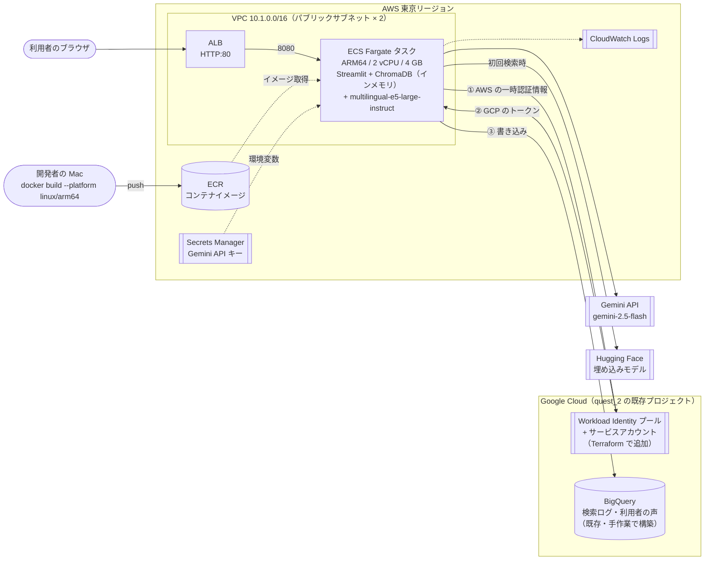
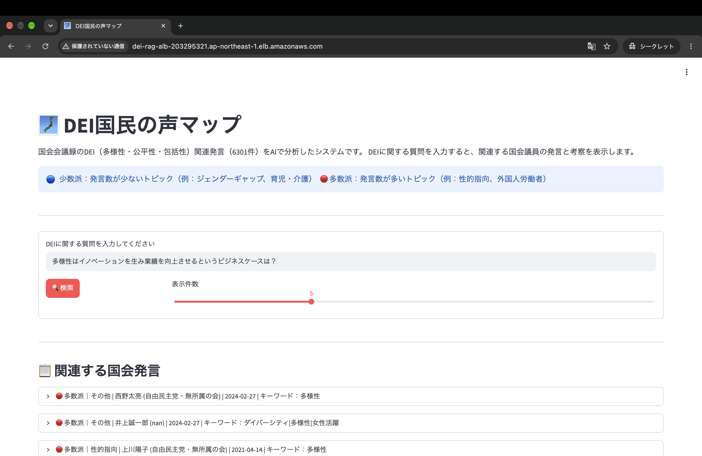
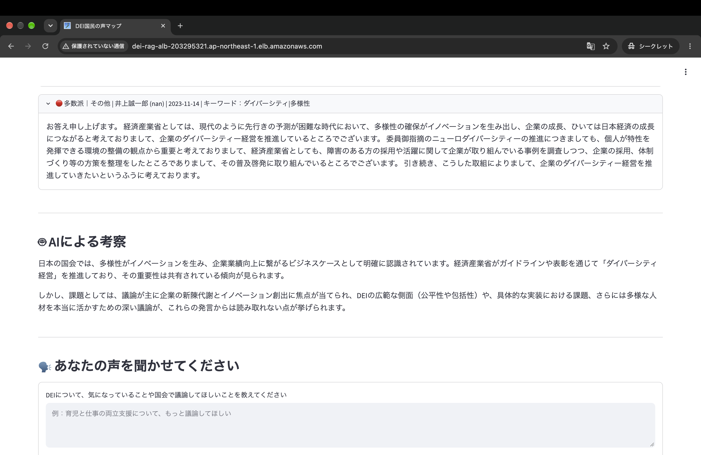
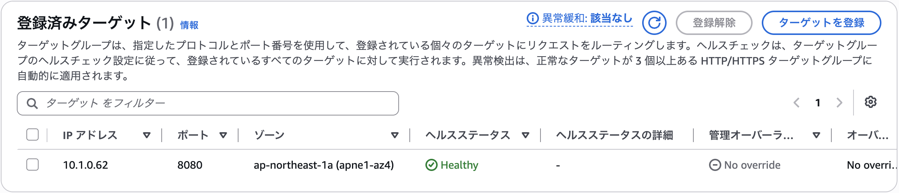
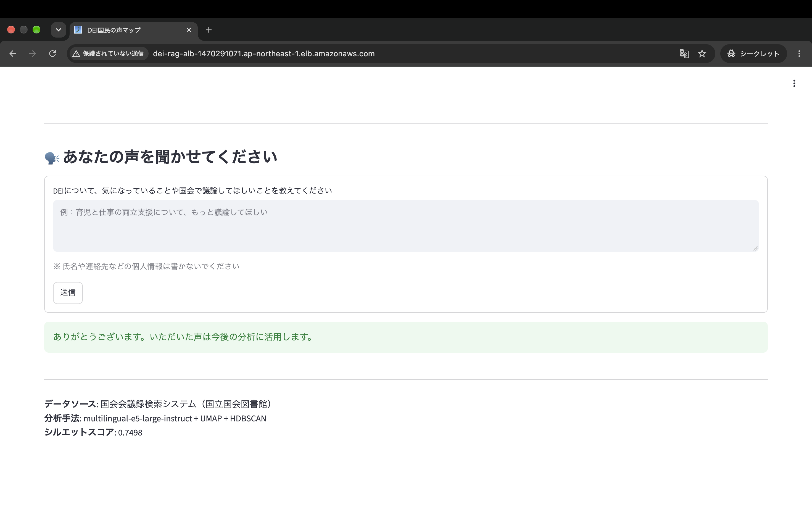
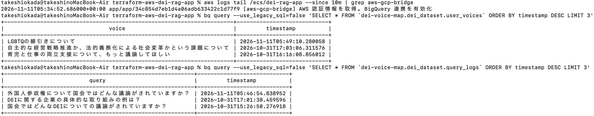

# terraform-aws-dei-rag-app

自作の RAG アプリ「**DEI 国民の声マップ**」（[quest_2](https://github.com/takeoka96/quest_2)）を、Google Cloud（Cloud Run）に加えて **AWS（ECS Fargate）でも動かす**ための Terraform コードです。

アプリのコードは quest_2 に置いたまま、このリポジトリには**インフラのコードだけ**を置いています（アプリとインフラのリポジトリを分ける構成）。

**目的**: 同じコンテナを Cloud Run と AWS の両方で動かし、マネージドなサーバーレス実行環境と、ネットワークから自分で組み立てる構成の違いを比較すること。さらに、AWS で動くアプリから GCP の BigQuery へ、**秘密鍵を使わずに**（Workload Identity 連携）書き込めるようにした。

## 構成図



| 要素 | 内容 |
|---|---|
| ネットワーク | VPC、パブリックサブネット 2（1a・1c）、IGW。NAT ゲートウェイなし |
| 入口 | ALB（HTTP:80）→ ターゲットグループ（IP ターゲット、8080、ヘルスチェック `/_stcore/health`） |
| 実行環境 | ECS Fargate、ARM64（Graviton）、2 vCPU / 4 GB、常時 1 タスク |
| イメージ | ECR。quest_2 の Dockerfile を Mac で ARM64 ビルドし、AWS → GCP 接続用の入口スクリプト（`docker/`）を上乗せして push |
| 秘密情報 | Gemini API キーを Secrets Manager に保存し、実行ロール経由で環境変数として注入 |
| ログ | CloudWatch Logs（3 日保持） |
| GCP 連携 | Workload Identity 連携。ECS のタスクロールだけが、BigQuery の 2 テーブルに書き込めるサービスアカウントになりすませる |
| セキュリティグループ | インターネット → ALB(80) → ECS(8080) と、手前の SG からのみ許可 |

## 動作確認（第 1 段階）

`terraform apply` で構築し、AWS 上で動作を確認したときの記録です。

### ALB 経由で検索できる

URL が ALB のアドレスになっており、AWS 上で動いています。「6301 件」はイメージ内の CSV と埋め込みから ChromaDB に登録された件数で、Cloud Run 版（外部の ChromaDB）と同じデータを、アプリのコードを変えずに読み込めています。



### Gemini による考察が生成される

Secrets Manager に保存した API キーが、ECS の実行ロール経由で環境変数として渡されています。



### ALB のヘルスチェックを通過

Fargate のタスクは IP（VPC 10.1.0.0/16 内）でターゲットグループに登録され、Streamlit のヘルスチェック `/_stcore/health` を通過しています。



## 第 2 段階：AWS から BigQuery へ秘密鍵なしで書き込む

### 仕組み（Workload Identity 連携）

1. ECS タスクが、AWS のタスクロール（`dei-rag-ecs-task-role`）の一時的な認証情報で「自分が誰か」を証明する
2. GCP の Workload Identity プールが、AWS アカウント ID とロール名を確認し、GCP の一時的なトークンと交換する。このロール以外からの要求は `attribute_condition` で拒否する
3. そのトークンでサービスアカウント `dei-rag-aws-writer` になりすまし、BigQuery の `query_logs` と `user_voices` の 2 テーブルだけに書き込む

サービスアカウントの秘密鍵（JSON キー）はどこにも存在しないため、漏えいや定期的なローテーションの心配がない。

### quest_2 のコードを変えずに実現した方法

Google の認証ライブラリ（google-auth）は、AWS の認証情報を「環境変数」か「EC2 のメタデータサーバー」から取得するが、ECS Fargate はどちらも使わず専用のエンドポイントで認証情報を配るため、そのままでは動かない。

そこで、quest_2 のイメージに小さな入口スクリプト（[`docker/entrypoint.py`](docker/entrypoint.py)）を上乗せした AWS 専用のイメージを作り、次の処理をしてから Streamlit を起動するようにした。

- ECS のエンドポイントから AWS の一時的な認証情報を取得し、google-auth が読める環境変数に入れる
- 認証情報は数時間で入れ替わるため、バックグラウンドで 15 分ごとに取り直す
- Terraform が作った接続設定（秘密情報を含まない JSON）を `GOOGLE_APPLICATION_CREDENTIALS` で渡す

quest_2 の `app.py` から見ると、Cloud Run のときと同じく `bigquery.Client()` がそのまま動くだけで、**アプリのコードは 1 行も変更していない**。

### 動作確認

第 1 段階では GCP の認証情報がなくエラーになっていた「あなたの声」の送信が、AWS 上で成功するようになった。



ECS のログで入口スクリプトが連携を有効化したことと、アプリから送った検索と「あなたの声」が、Cloud Run 版と同じ BigQuery のテーブルに書き込まれたことを確認した。10/31 の行は Cloud Run 版、11/11 の行が AWS 版からの書き込み。



### IaC の適用範囲

quest_2 の GCP 環境（Cloud Run、BigQuery、GA4、Looker Studio など）は、IaC を学ぶ前に手作業で構築したもので、今回もそのまま残している。Terraform で管理するのは、**このリポジトリで新しく追加した接続のための部品だけ**（Workload Identity プール、プロバイダ、サービスアカウント、テーブル単位の権限）で、既存のデータセットやテーブルは名前で参照するだけにした。権限も「既存テーブルにメンバーを 1 人追加する」形式で、既存の権限設定は変更しない。

既存の手作業の環境は壊さずに、新しく足すものからコードで管理していく、という進め方にした。

## Cloud Run 版との比較

| 項目 | Cloud Run 版（GCP） | AWS 版（このリポジトリ） |
|---|---|---|
| 実行環境 | Cloud Run（2 vCPU / 4 GiB） | ECS Fargate（2 vCPU / 4 GB） |
| CPU アーキテクチャ | x86_64 | ARM64（Graviton。x86 より約 2 割安い） |
| 入口・URL | Cloud Run が URL と HTTPS を自動で発行 | VPC・サブネット・SG・ALB・ターゲットグループを自分で構築 |
| イメージ置き場 | Artifact Registry | ECR |
| ChromaDB | 別サービス `chroma` に HTTP で接続 | アプリ内でインメモリ起動し、イメージ内の CSV / 埋め込みから登録 |
| API キー | Cloud Run のサービス設定 | Secrets Manager。値は Terraform の write-only 属性で渡し、**tfstate にも残らない** |
| BigQuery への書き込み | 同じ GCP 内なのでサービスアカウントで自動認証 | Workload Identity 連携。AWS の一時認証情報を GCP のトークンに交換し、**秘密鍵なし**で書き込む |
| 課金 | リクエストがないときは 0 台まで縮退 | ALB とタスクが常時課金（約 0.14 USD / 時）。確認後に destroy |
| 構築方法 | gcloud / コンソール | `terraform apply` |

**分かったこと**: Cloud Run は「コンテナを渡せば URL が出る」ところまでを肩代わりしてくれるのに対し、AWS ではネットワークとロードバランサーを自分で設計する必要がある。その分、通信経路（SG の連鎖）や権限（実行ロールとタスクロールの分離）をコードで細かく制御できる。ネットワークと ALB の部分は [terraform-aws-wordpress](https://github.com/takeoka96/terraform-aws-wordpress) と同じ設計を再利用した。

### ChromaDB の構成を変えた理由

Cloud Run 版は ChromaDB を別サービスに分けているが、AWS 版では 1 コンテナにまとめた。データは約 6,300 件と小さく、起動時にメモリへ登録しても数十秒で終わるため。`app.py` は環境変数 `CHROMA_HOST` の有無で接続先を切り替える作りになっており、**アプリのコードは変更せずに**構成だけを変えられた。

## 進め方

| 段階 | 内容 | 状態 |
|---|---|---|
| 第 1 段階 | ECS Fargate で動かす（検索と AI 考察） | 完了 |
| 第 2 段階 | Workload Identity 連携で、AWS からキーなしで BigQuery に書き込む | 完了 |

## 使い方

### 前提

- Terraform 1.11 以上、Docker、AWS CLI
- AWS の認証情報（`aws configure`）
- Gemini API キー
- gcloud CLI と、quest_2 の GCP プロジェクトへのログイン（`gcloud auth application-default login`）
- [quest_2](https://github.com/takeoka96/quest_2) のフォルダと、その中の `data/speeches_clustered.csv` と `data/embeddings_round5.npy`（Git には含まれていないため、手元にあるもの）

### 構築

```bash
# 1. Gemini API キーを環境変数で渡す（ファイルには書かない）
export TF_VAR_gemini_api_key="Gemini API キー"

# 2. 初期化
terraform init

# 3. まずイメージ置き場（ECR）だけ作る
terraform apply -target=aws_ecr_repository.app

# 4. アプリをビルドして push（quest_2 のパスを指定。初回は 10 分ほど）
./scripts/push_image.sh ~/quest_2

# 5. 残りをすべて作る（約 5 分）
terraform apply
```

完了すると URL が表示されます。タスクの起動とヘルスチェックの通過まで、さらに 2〜3 分待ってから開いてください。初回の検索は埋め込みモデルのダウンロードのため 1 分ほどかかります。

```
app_url = "http://dei-rag-alb-xxxxxxxx.ap-northeast-1.elb.amazonaws.com"
```

ECR だけ先に作るのは、ECS がタスクを起動する時点でイメージが存在している必要があるためです。

### アプリを更新したとき

```bash
./scripts/push_image.sh ~/quest_2
```

イメージを push し、ECS のタスクを新しいイメージで入れ替えます。

### 削除

```bash
terraform destroy
```

ECR のイメージ、シークレットも含めてすべて削除されます。`TF_VAR_gemini_api_key` が設定されたターミナルで実行してください。

GCP 側は、このリポジトリで追加した部品（Workload Identity プール、サービスアカウント、テーブルへの権限）だけが削除されます。既存の BigQuery のデータやテーブル、Cloud Run 版には影響しません。API は quest_2 も使っているため、destroy しても無効化しない設定にしています。

## 費用の目安

東京リージョン、オンデマンド料金での概算です。

| リソース | 時間あたり |
|---|---|
| Fargate ARM 2 vCPU / 4 GB | 約 0.10 USD |
| ALB | 約 0.024 USD + LCU |
| パブリック IPv4（タスク 1 + ALB 2） | 約 0.015 USD |
| **合計** | **約 0.14 USD / 時間** |

このほか、ECR のイメージ保存（約 2GB、月 0.2 USD 程度）と Secrets Manager（月 0.4 USD、日割り）がかかります。GCP 側の Workload Identity 連携とサービスアカウントは無料です。

## ファイル構成

```
.
├── versions.tf          # Terraform とプロバイダのバージョン
├── variables.tf         # 変数（Gemini API キーは ephemeral）
├── network.tf           # VPC、サブネット、IGW、セキュリティグループ
├── alb.tf               # ALB、ターゲットグループ、リスナー
├── ecr.tf               # コンテナイメージのリポジトリ
├── secrets.tf           # Secrets Manager（write-only でキーを保存）
├── ecs.tf               # ECS クラスター、タスク定義、サービス、IAM ロール
├── gcp.tf               # Workload Identity プール、サービスアカウント、BigQuery の権限
├── outputs.tf
├── docker/
│   ├── Dockerfile       # quest_2 のイメージに入口スクリプトを上乗せ
│   └── entrypoint.py    # Fargate の認証情報を google-auth に渡して Streamlit を起動
├── scripts/
│   └── push_image.sh    # 2 段階ビルドと ECR への push、タスク入れ替え
└── terraform.tfvars.example
```

## 既知の制限と今後の改善点

- **BigQuery の権限がやや広い**: `roles/bigquery.dataEditor` はテーブルの読み取りも含む。書き込みだけに絞るなら `bigquery.tables.updateData` だけのカスタムロールにできる
- **quest_2 の GCP 環境は IaC 化していない**: 下記「IaC の適用範囲」を参照
- **HTTP のみ**: 独自ドメインと ACM 証明書で HTTPS 化できる（terraform-aws-wordpress と同じ方法）
- **イメージに未使用のデータが入っている**: quest_2 の `data/` には、アプリが使わない過去の埋め込み（round1〜4, 6）や生データが含まれ、約 140MB 余分。`.dockerignore` で除外できる
- **埋め込みモデルを起動のたびにダウンロードしている**: ビルド時にイメージへ含めれば初回検索の待ち時間がなくなる（代わりにイメージが約 2GB 大きくなる）
- **ECS タスクがパブリックサブネットにある**: 受信は ALB からのみに制限済み。より厳密にするなら、プライベートサブネット + VPC エンドポイント（ECR、Secrets Manager、Logs）にする（費用増）
- **コンテナのヘルスチェックが未設定**: ALB のヘルスチェックで正常性は確認しているが、ECS のタスク画面ではヘルスステータスが「不明」と表示される。タスク定義に `healthCheck` を追加すれば ECS 側でも判定できる
- **常時 1 タスク**: 利用がないときは `desired_count = 0` にすれば ALB 以外の課金を止められる
